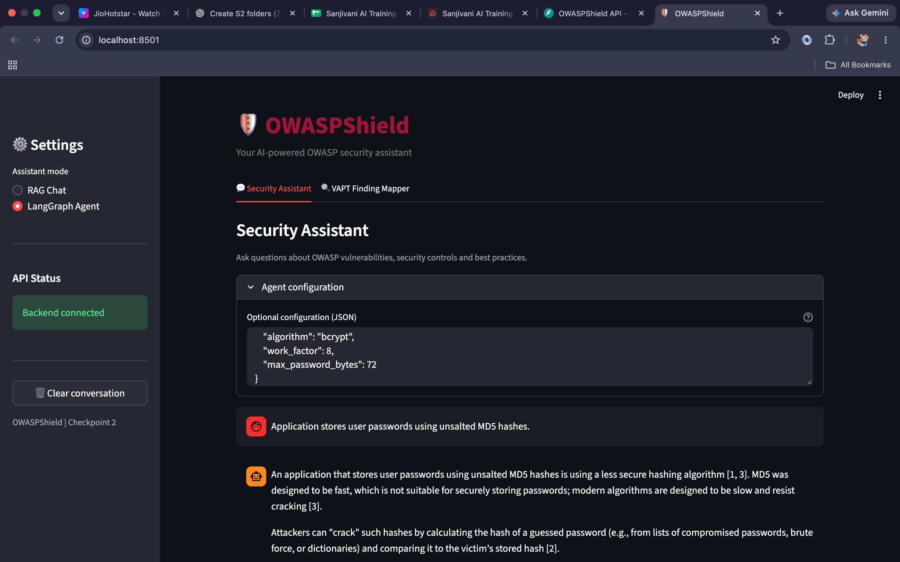

# OWASPShield

## Project Overview

OWASPShield is a beginner-friendly cybersecurity awareness and security assistance project designed to help users understand common web application security risks.

## Product

A cybersecurity assistant that provides information about common web security vulnerabilities and basic security checks.

## Target Users

Students, beginner developers, and individuals interested in learning web application security.

## Problem

Many beginners are unaware of common web application vulnerabilities and struggle to understand how to identify basic security risks.

## Data Source

OWASP Top 10 documentation and manually prepared sample security questions and rules.

## Project Goal

To make basic web security knowledge easier to understand through a Python-based interactive application powered by Retrieval-Augmented Generation (RAG) and AI agents.

## Features

- Search cybersecurity cheat sheet records.
- Search records using semantic search.
- Ask cybersecurity questions through a RAG-based assistant.
- Retrieve relevant information from embedded OWASP security documents.
- Generate answers with source citations.
- Return `I don't know` when retrieved information does not support an answer.
- Execute password hashing configuration checks through an AI agent.
- Require human approval before executing security tools.
- Map VAPT findings to relevant security cheat sheets.
- Generate remediation checklists.
- Collect positive and negative user feedback.

---

## RAG-Based Question Answering

OWASPShield uses Retrieval-Augmented Generation (RAG).

1. The user's question is converted into an embedding.
2. Relevant document chunks are retrieved using vector similarity search.
3. Retrieved chunks are passed to the language model as context.
4. The model generates an answer using the retrieved information.
5. Citations identify the sources used for the answer.

### API Endpoint

`POST /ask`

Example request:

```json
{
  "question": "How should I store user passwords securely?"
}
```

The response contains:

- The original question
- The generated answer
- Citations containing document titles and source filenames

If the retrieved information is insufficient, the API returns exactly `I don't know`.

---

## Retrieval Evaluation (Day 8 - S2)

Two retrieval configurations were evaluated using a dataset of 15 questions.

Keyword coverage measures how many expected keywords were found in the retrieved chunks for the 14 answerable questions. Q6 is an abstention test and is excluded from the keyword coverage average.

| Configuration | Chunk Size | Overlap | Top-K | Average Keyword Coverage |
|---|---:|---:|---:|---:|
| A | 500 | 75 | 3 | 64.29% |
| B | 1000 | 150 | 5 | 77.38% |

### Selected Configuration

**Configuration B** achieved the higher average keyword coverage of **77.38%**.

Selected settings:

- Chunk size: 1000
- Overlap: 150
- Top-K: 5

These results compare the two complete configurations; they do not isolate the effect of each individual parameter.

### Abstention Test

The unsupported AWS CloudTrail question (Q6) was tested through the `/ask` API.

- Expected response: `I don't know`
- Actual response: `I don't know`
- Citations: Empty list

---

## AI Agent and LangGraph

OWASPShield includes an AI agent that can select and execute cybersecurity tools.

### S1 – Custom Agent and Security Tool

- `app/tools.py` – Password hashing configuration checker.
- `app/agent_loop.py` – Hand-written agent that selects between RAG search and the password configuration checker.
- Checks Argon2id, bcrypt, and PBKDF2 configurations against the project's configured minimum requirements.

### Password Hashing Configuration Checks

The checker evaluates:

| Algorithm | Configuration requirement |
|---|---|
| Argon2id | Memory ≥ 19 MiB and iterations ≥ 2 |
| bcrypt | Work factor ≥ 10 and maximum password bytes ≤ 72 |
| PBKDF2 | Iterations ≥ 600,000 |

### S2 – LangGraph Agent

- `app/graph.py` – Implements the agent workflow using LangGraph.
- Uses conditional routing to select the appropriate tool.
- Includes human approval before password configuration checks.
- Supports approval and rejection.
- Uses LangGraph MemorySaver to maintain conversation state.
- Stores conversation history using thread IDs.

### Agent API

**Endpoint:** `POST /agent`

The agent supports two workflows:

1. Cybersecurity questions are routed to the RAG search system and returned with citations.
2. Password hashing configuration checks require human approval before execution.

**Example: Start an agent request**

```json
{
  "question": "Check this password hashing config",
  "config": {
    "algorithm": "bcrypt",
    "work_factor": 8,
    "max_password_bytes": 72
  },
  "thread_id": "test-agent-001",
  "resume": false
}
```

**Example: Approve execution**

```json
{
  "thread_id": "test-agent-001",
  "resume": true,
  "approved": true
}
```

**Example: Reject execution**

```json
{
  "thread_id": "test-agent-002",
  "resume": true,
  "approved": false
}
```

---

## Streamlit Interface (Checkpoint 2)

OWASPShield includes a Streamlit-based graphical interface that makes the cybersecurity assistant easier to use.

### 1. RAG Chat

- Ask questions about OWASP vulnerabilities and security best practices.
- Receive AI-generated answers based on retrieved security documents.
- View source citations associated with answers.

### 2. LangGraph Agent

- Interact with the LangGraph-powered AI agent.
- Route questions to the appropriate security functionality.
- Review tool execution requests.
- Approve or reject security tool execution.
- View password hashing configuration results.

### 3. VAPT Finding Mapper

- Paste a security finding from a VAPT report.
- Search for matching cybersecurity cheat sheets.
- Identify related vulnerabilities and OWASP categories.
- Display recommended security controls and configuration parameters.
- Generate a remediation checklist with interactive checkboxes.

### 4. User Feedback

- Submit thumbs-up or thumbs-down feedback on assistant responses.
- Store submitted feedback in `data/feedback.json`.
- Keep generated feedback data out of Git using `.gitignore`.

### Checkpoint 2 Screenshot



---

## Technologies Used

- **Python** – Core programming language.
- **FastAPI** – Backend API development.
- **Streamlit** – Interactive user interface.
- **LangGraph** – AI agent workflow and human approval.
- **ChromaDB** – Vector database for semantic retrieval.
- **Google Gemini** – Embeddings and generative AI.
- **OWASP Documentation** – Cybersecurity knowledge source.
- **JSON** – Data storage and configuration.

---

## Project Structure

```text
GENAI/
│
├── app/
│   ├── main.py
│   ├── rag.py
│   ├── graph.py
│   ├── tools.py
│   ├── agent_loop.py
│   └── ...
│
├── data/
│   ├── sample_records.py
│   ├── chunks.json
│   └── ...
│
├── eval/
│   ├── eval_set.json
│   └── run_eval.py
│
├── ui/
│   └── app.py
│
├── screenshots/
│   └── checkpoint-2.png
│
├── analysis/
├── requirements.txt
├── .gitignore
└── README.md
```

*Generated files and additional modules may not be shown in this simplified structure.*

---

## How to Run

### 1. Clone the Repository

```bash
git clone https://github.com/falak8484/GENAI.git
cd GENAI
```

### 2. Create a Virtual Environment

```bash
python3 -m venv .venv
```

### 3. Activate the Virtual Environment

```bash
source .venv/bin/activate
```

### 4. Install Dependencies

```bash
python -m pip install -r requirements.txt
```

### 5. Start the FastAPI Backend

```bash
uvicorn app.main:app --reload
```

### 6. Open API Documentation

Visit:

http://127.0.0.1:8000/docs

### 7. Start the Streamlit Application

Open a second terminal, activate the virtual environment, and run:

```bash
streamlit run ui/app.py
```

Open the local Streamlit URL displayed in the terminal.

### 8. Run Data Analysis

```bash
python -m analysis.explore
```

### 9. Run Smart Search

```bash
python -m app.smart_search
```

### 10. Run Retrieval Evaluation

```bash
python -m eval.run_eval
```

---

## Repository

GitHub: https://github.com/falak8484/GENAI

## Project Status

**Checkpoint 2 – Streamlit Interface and AI Agent Integration**

Implemented capabilities include RAG-based question answering, semantic retrieval, LangGraph agent workflows, human approval, password hashing configuration checks, VAPT finding mapping, remediation checklists, and user feedback.

## Run with Docker

OWASPShield can be started using Docker Compose. Docker and Docker Compose must be installed.

### 1. Configure environment variables

Create a `.env` file in the project root and add your required environment variables:

```env
GEMINI_API_KEY=your_api_key_here
```

### 2. Build and start the services

```bash
docker compose up --build
```

### 3. Access the application

- **Streamlit UI:** http://localhost:8501
- **FastAPI API:** http://localhost:8000
- **API documentation:** http://localhost:8000/docs

### 4. Stop the services

```bash
docker compose down
```