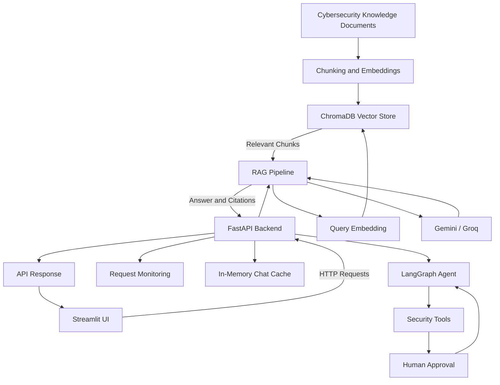

# OWASPShield


**An AI-powered cybersecurity assistant that helps students and beginner developers understand web application vulnerabilities through RAG, semantic search, and AI agent workflows.**

OWASPShield combines retrieval-grounded answers, source citations, defensive security checks, and human-approved agent workflows in one application.

**Live API:** https://owaspshield-api-falak.onrender.com

**API Documentation:** https://owaspshield-api-falak.onrender.com/docs
**GitHub Repository:** https://github.com/falak8484/GENAI

---

## Project Overview

OWASPShield is a Python-based cybersecurity learning and assistance platform designed around the OWASP Top 10 and secure development practices.

### Problem

Students and beginner developers often struggle to understand web application vulnerabilities, find reliable security guidance, and translate security findings into practical remediation steps.

### Solution

OWASPShield provides an interactive cybersecurity assistant that combines:

- Retrieval-Augmented Generation (RAG).
- Semantic search across cybersecurity knowledge records.
- AI-generated answers with source citations.
- LangGraph agent workflows with human approval.
- Password hashing configuration checks.
- VAPT finding mapping and remediation checklists.
- API monitoring, input validation, and response caching.

### Target Users

- Cybersecurity students.
- Beginner developers.
- Individuals interested in application security.
- Learners exploring secure coding practices.

### Data Sources

OWASP documentation, manually prepared cybersecurity records, and security knowledge documents.

### Project Goal

To make cybersecurity knowledge easier to understand while demonstrating practical implementation of RAG, AI agents, API development, and defensive security controls.

---

## Architecture

OWASPShield follows a modular architecture connecting its Streamlit interface, FastAPI backend, retrieval pipeline, language models, and security agent.



### Main Components

| Component | Responsibility |
|---|---|
| Streamlit | Interactive user interface |
| FastAPI | Backend API and request handling |
| RAG | Context-based cybersecurity question answering |
| Embeddings | Convert questions and documents into vectors |
| ChromaDB | Store and retrieve embedded document chunks |
| Gemini / Groq | Generate language model responses |
| LangGraph | Agent workflow and conditional routing |
| Security tools | Password hashing configuration checks |
| Monitoring | Request latency and LLM usage logging |
| Cache | Reduce repeated `/chat` LLM calls |

---

## Features

### 1. Cybersecurity Knowledge Search

- Search cybersecurity cheat sheet records.
- Search records using semantic similarity.
- Retrieve vulnerability information and recommended controls.
- Identify relevant OWASP categories and security parameters.

### 2. RAG-Based Question Answering

OWASPShield uses Retrieval-Augmented Generation to answer cybersecurity questions using retrieved knowledge documents.

**Retrieval workflow:**

1. The user's question is converted into an embedding.
2. ChromaDB retrieves relevant document chunks using vector similarity.
3. Retrieved chunks are checked against a minimum similarity threshold.
4. Relevant context is passed to the language model.
5. The model generates an answer using the provided context.
6. Citations identify the sources used.

The RAG pipeline uses a minimum similarity threshold of `0.65`.

If relevant information is unavailable or insufficient, the system returns exactly:

```text
I don't know
```

This helps prevent unsupported answers.

**API Endpoint:** `POST /ask`

Example request:

```json
{
  "question": "How should I store user passwords securely?"
}
```

The response includes:

- Original question.
- Generated answer.
- Citations with document titles and source information.

### 3. AI Agent and LangGraph

OWASPShield includes AI agent workflows that can select between cybersecurity question answering and security configuration checks.

#### Custom Agent

- `app/agent_loop.py` implements a hand-written agent loop.
- `app/tools.py` contains the password hashing configuration checker.
- Routes between RAG search and password configuration checks.

#### LangGraph Agent

- `app/graph.py` implements the agent workflow.
- Uses conditional routing to select the appropriate tool.
- Includes human approval before password configuration checks.
- Supports approval and rejection.
- Uses LangGraph `MemorySaver` to maintain conversation state.
- Stores conversation history using thread IDs.

**API Endpoint:** `POST /agent`

The agent supports two workflows:

1. Cybersecurity questions are routed to the RAG search system and returned with citations.
2. Password hashing configuration checks require human approval before execution.

Example: Start an agent request.

```json
{
  "question": "Check this password hashing config",
  "config": {
    "algorithm": "bcrypt",
    "work_factor": 8,
    "max_password_bytes": 72
  },
  "thread_id": "test-agent-001",
  "resume": false
}
```

Example: Approve execution.

```json
{
  "thread_id": "test-agent-001",
  "resume": true,
  "approved": true
}
```

Example: Reject execution.

```json
{
  "thread_id": "test-agent-002",
  "resume": true,
  "approved": false
}
```

### 4. Password Hashing Configuration Checks

The security tool evaluates password hashing configurations against the project's configured minimum requirements.

| Algorithm | Configuration requirement |
|---|---|
| Argon2id | Memory ≥ 19 MiB and iterations ≥ 2 |
| bcrypt | Work factor ≥ 10 and maximum password bytes ≤ 72 |
| PBKDF2 | Iterations ≥ 600,000 |

These checks are intended for defensive configuration learning and validation.

### 5. VAPT Finding Mapper

The VAPT Finding Mapper helps users connect security findings with relevant cybersecurity knowledge.

- Paste a security finding from a VAPT report.
- Search for matching cybersecurity cheat sheets.
- Identify related vulnerabilities and OWASP categories.
- Display recommended security controls and configuration parameters.
- Generate a remediation checklist with interactive checkboxes.

### 6. User Feedback

- Submit thumbs-up or thumbs-down feedback on assistant responses.
- Store submitted feedback in `data/feedback.json`.
- Keep generated feedback data out of Git using `.gitignore`.

### 7. Streamlit Interface

The Streamlit interface provides an interactive way to use OWASPShield.

It includes:

- RAG Chat.
- LangGraph Agent.
- Human approval and rejection controls.
- Password hashing configuration results.
- VAPT Finding Mapper.
- Interactive remediation checklists.
- User feedback.

**Interface screenshot:**


---

## Retrieval Evaluation

Two retrieval configurations were evaluated using a dataset of 15 questions.

Keyword coverage measures how many expected keywords were found in the retrieved chunks for the 14 answerable questions. Q6 is an abstention test and is excluded from the keyword coverage average.

| Configuration | Chunk Size | Overlap | Top-K | Average Keyword Coverage |
|---|---:|---:|---:|---:|
| A | 500 | 75 | 3 | 64.29% |
| B | 1000 | 150 | 5 | 77.38% |

### Selected Configuration

**Configuration B** achieved the higher average keyword coverage of **77.38%**.

Selected settings:

- Chunk size: 1000.
- Overlap: 150.
- Top-K: 5.

These results compare the two complete configurations; they do not isolate the effect of each individual parameter.

### Abstention Test

The unsupported AWS CloudTrail question (Q6) was tested through the `/ask` API.

| Metric | Result |
|---|---|
| Expected response | `I don't know` |
| Actual response | `I don't know` |
| Citations | Empty list |
| Result | Passed |

---

## Production Monitoring and Performance

OWASPShield includes basic production-oriented monitoring, response caching, and input validation.

### Request Monitoring

Each API request logs:

- HTTP method.
- Endpoint.
- HTTP status code.
- Total request latency in milliseconds.

### LLM Usage Monitoring

Each LLM call logs:

- LLM provider.
- LLM execution latency.
- Input tokens.
- Output tokens.
- Total tokens.

### Response Caching

A simple in-memory cache reduces repeated language model calls for the `/chat` endpoint.

- Cache TTL: 300 seconds (5 minutes).
- Maximum cache entries: 100.
- Cache keys use the task and normalized question.
- Repeated cached requests avoid another LLM call.

**Cache limitation:** The cache is in-memory. Entries are lost when the application restarts and are not shared between separate application processes.

### Measured Performance

**Test environment:** Local FastAPI server using Gemini 2.5 Flash.

| Metric | First Request | Cached Request |
|---|---:|---:|
| Cache status | Miss | Hit |
| Request latency | 15,603.19 ms | 3.39 ms |
| LLM latency | 15,583.64 ms | Not called |
| Input tokens | 310 | 0 additional |
| Output tokens | 1,683 | 0 additional |
| Total tokens | 1,993 | 0 additional |

The repeated request showed approximately **99.98% lower latency** in this test.

These measurements represent a single local test and are not a general performance guarantee. Actual results may vary with network conditions and provider response times.

### Input Validation and Security

- API input lengths are restricted using Pydantic validation.
- User-provided content is treated as untrusted input.
- System instructions include prompt-injection resistance rules.
- Automated tests verify input limits, prompt boundaries, and cache behavior.

The prompt-injection test verifies that user input does not replace the application's system instructions at the prompt-construction boundary. It does not guarantee resistance to every possible prompt injection.

---

## Testing and Code Quality

The project includes automated API and cache tests.

**Day 13 test results:**

| Check | Result |
|---|---:|
| Total automated tests | 29 |
| Passed | 29 |
| Failed | 0 |
| Ruff lint checks | Passed |
| GitHub Actions CI | Passed |

GitHub Actions runs the project's automated quality checks and Docker build as part of the CI pipeline.

[View GitHub Actions](https://github.com/falak8484/GENAI/actions)

---

## Technologies Used

| Technology | Purpose |
|---|---|
| Python | Core programming language |
| FastAPI | Backend API development |
| Streamlit | Interactive user interface |
| LangGraph | AI agent workflows and human approval |
| ChromaDB | Vector database and semantic retrieval |
| Google Gemini | Embeddings and generative AI |
| Groq | Alternative LLM provider |
| Docker | Containerization |
| Docker Compose | Multi-service local deployment |
| Pytest | Automated testing |
| Ruff | Code quality and linting |
| GitHub Actions | Continuous integration |
| Render | Live API deployment |
| JSON | Data storage and configuration |

---

## Project Structure

```text
GENAI/
│
├── app/
│   ├── __init__.py
│   ├── main.py
│   ├── rag.py
│   ├── llm.py
│   ├── embed.py
│   ├── vectorstore.py
│   ├── chunking.py
│   ├── ingest.py
│   ├── fetch.py
│   ├── records.py
│   ├── smart_search.py
│   ├── graph.py
│   ├── agent_loop.py
│   ├── tools.py
│   ├── cache.py
│   ├── monitoring.py
│   ├── models.py
│   └── cli.py
│
├── data/
│   ├── raw/
│   ├── chroma_db/
│   ├── chunks.json
│   ├── embedded_chunks.json
│   ├── records.json
│   └── sample_records.py
│
├── eval/
│   ├── eval_set.json
│   └── run_eval.py
│
├── ui/
│   └── app.py
│
├── prompts/
│   └── system.txt
│
├── tests/
│   ├── test_api.py
│   └── test_cache.py
│
├── screenshots/
│   └── checkpoint-2.png
│
├── docs/
├── analysis/
├── requirements.txt
├── Dockerfile
├── docker-compose.yml
├── pyproject.toml
├── .gitignore
└── README.md
```

*Generated files and additional modules may not be shown in this simplified structure.*

---

## Live Deployment

The OWASPShield FastAPI backend is deployed on Render using Docker.

- **API Base URL:** https://owaspshield-api-falak.onrender.com
- **Health Check:** https://owaspshield-api-falak.onrender.com/health
- **Swagger Documentation:** https://owaspshield-api-falak.onrender.com/docs

**Deployment platform:** Render (Docker).

The Streamlit interface is available for local and Docker-based execution; the current Render deployment hosts the API backend.

**Note:** The Render Free instance may spin down after inactivity, resulting in a delay on the first request.

---

## Demo Video

A project walkthrough video will be added here.

**Demo:** Coming soon.

The planned walkthrough will demonstrate:

1. OWASPShield interface and cybersecurity search.
2. RAG-based question answering with citations.
3. Semantic retrieval.
4. LangGraph agent workflow and human approval.
5. Password hashing configuration checks.
6. VAPT finding mapping.
7. Live API documentation and deployment.

---

## How to Run Locally

### Prerequisites

- Python 3.11 recommended.
- Docker and Docker Compose (optional).
- Gemini API key or Groq API key, depending on the selected provider.

### 1. Clone the Repository

```bash
git clone https://github.com/falak8484/GENAI.git
cd GENAI
```

### 2. Create a Virtual Environment

```bash
python3 -m venv .venv
```

### 3. Activate the Virtual Environment

```bash
source .venv/bin/activate
```

### 4. Install Dependencies

```bash
python -m pip install -r requirements.txt
```

### 5. Configure Environment Variables

Create a `.env` file in the project root.

For Gemini:

```env
LLM_PROVIDER=gemini
GEMINI_API_KEY=your_api_key_here
```

For Groq, configure the corresponding provider and API key according to the application's environment settings.

**Important:** Never commit `.env` files or expose API keys in screenshots, logs, or public repositories.

### 6. Start the FastAPI Backend

```bash
uvicorn app.main:app --reload
```

### 7. Open API Documentation

Visit:

http://127.0.0.1:8000/docs

### 8. Start the Streamlit Application

Open a second terminal, activate the virtual environment, and run:

```bash
streamlit run ui/app.py
```

Open the local Streamlit URL displayed in the terminal.

---

## Run with Docker

Docker and Docker Compose must be installed.

### 1. Configure Environment Variables

Create a `.env` file in the project root and add the required API key and provider configuration.

### 2. Build and Start the Services

```bash
docker compose up --build
```

### 3. Access the Application

- **Streamlit UI