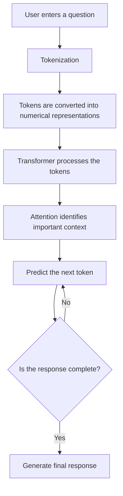

# How Large Language Models (LLMs) Work

## 1. What is an LLM?

A Large Language Model (LLM) is an AI model that understands and generates human-like text.

It is trained using a large amount of text from books, articles, websites and other sources. By learning patterns in this text, it can answer questions, explain topics, summarize information and generate content.

Examples of LLMs include GPT, Gemini and Llama.

## 2. How does an LLM work?

An LLM works in a few main steps:

1. **User Input:** The user enters a question or instruction.
2. **Tokenization:** The model breaks the input into smaller pieces called tokens. A token can be a word, part of a word or a symbol.
3. **Processing:** The model processes these tokens using a neural network called a Transformer.
4. **Attention:** The attention mechanism helps the model understand which parts of the input are important in relation to other parts.
5. **Prediction:** The model predicts the next token based on the patterns it learned during training.
6. **Response:** It generates tokens one by one until the response is complete.

## 3. Diagram: Working of an LLM

## 4. How is an LLM trained?

LLMs are trained using large collections of text.

During training, the model learns language patterns by predicting the next token. It compares its predictions with the expected text and adjusts its internal parameters to improve.

## 5. Uses of LLMs

- Answering questions.
- Writing and summarizing content.
- Explaining technical topics.
- Generating and understanding code.
- Supporting chatbots.
- Helping with cybersecurity learning.

## 6. Limitations of LLMs

- They can generate incorrect information.
- They may produce answers that sound correct but are not factual. This is called hallucination.
- Their knowledge may not include recent information.
- They can misunderstand unclear questions.
- Their security recommendations should be verified.

## 7. How LLMs can help OWASPShield

An LLM could help OWASPShield users understand cybersecurity topics in simple language.

For example, a user might ask, "How can I store passwords securely?"

The LLM could explain password hashing, unique salts and recommended algorithms.

However, answers should be checked against trusted OWASP references. The model should not invent security recommendations when the available data does not support them.

## Conclusion

An LLM is an AI system that processes text and generates responses by predicting tokens based on patterns learned during training. It is useful for many tasks, but its answers should be verified, especially in cybersecurity.

